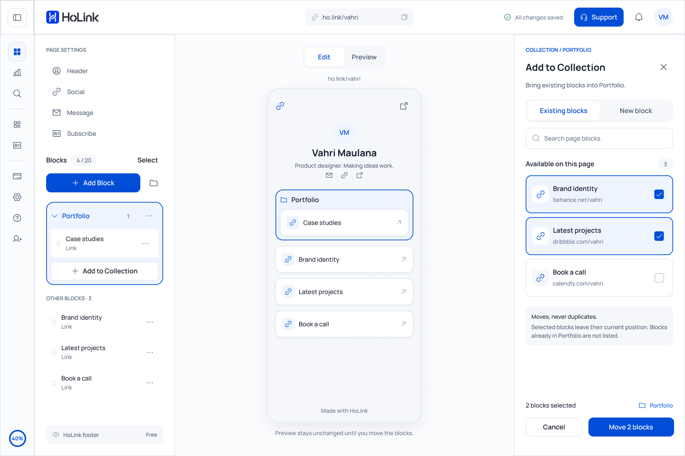

# HoLink Page Editor refinement

A focused UI/UX challenge exploring how creators organize existing page blocks into a Collection. Includes two editable Figma interaction states, before-and-after evidence, atomic design foundations, and a working localhost prototype.

[Open the Figma design](https://www.figma.com/design/mLcMwe2h5guYPYIuYbIBbc/Untitled?node-id=10-4679)

## Run locally

Requires **Node.js 20 or newer**. No package installation or build step is needed.

```sh
cd prototype
npm run dev
```

Open [localhost:5173](http://localhost:5173/). Edits are saved in the current browser. This is a local prototype; it does not publish changes to a live HoLink account.

## UX focus

Two issues observed in the original editor:

1. **Moving existing blocks into a Collection is difficult to discover.** The Collection's Add action leads to new block creation, while moving existing content requires a separate selection flow. The proposal makes Existing blocks and New block available from the Collection itself.
2. **Changing a URL can replace a custom link title.** This can undo deliberate copy and require users to re-enter it. The prototype preserves manually written titles when a URL changes.

The Figma proposal concentrates on the first issue:

- **Choose existing blocks:** search, select, confirm the destination, and move.
- **Collection updated:** list and preview reflect the new arrangement, with Undo available.

The existing three-panel structure, HoLink logo, and brand blue are retained. Primary buttons use solid **#004ED7**. Reusable components and token bindings preserve consistency. The additional selection/confirmation step adds a little effort while helping users check what will move and where.



## Project structure

| Directory | Contents |
| --- | --- |
| [`prototype/`](prototype/README.md) | Dependency-free browser app, native Node server, model tests, local assets, and screenshots |
| [`prototype/BLOCKS.md`](prototype/BLOCKS.md) | The working 15-type block catalogue, interactions, component organization, and verification boundaries |
| [`figma-design/`](figma-design/) | Figma authoring scripts, component/node ledger, icon assets, and exported design boards |
| [`figma-design/exports/`](figma-design/exports/) | Final two-screen refinement, before-and-after comparison, rationale, foundations, and interaction documentation |
| [`ux-review/`](ux-review/) | Screenshots collected while exploring the original HoLink interface |

Figma authoring scripts are executed in the Figma Desktop Bridge plugin context; they are not standalone Node programs. The current file state and node references are recorded in [`figma-design/state.json`](figma-design/state.json).

## Prototype interactions

- Add, edit, hide, reorder, remove, and restore content with Undo/Redo.
- Move multiple existing blocks into or between Collections without duplication.
- Create a block directly inside a Collection.
- Switch between Edit and audience Preview, and open the floating navigation drawer.
- Explore 15 block types: Links, QR Code, Title & Description, Dropdown, Content Separator, Image Slider, Music, Apple Podcast, PDF, YouTube Video, Calendly Booking, Email, Phone, WhatsApp, and Location.

The localhost prototype is broader than the two-screen Figma submission. Media and provider blocks use direct URLs; production uploads, account integrations, and publishing are outside this prototype.

## Verification

```sh
cd prototype
npm run check
npm test
npm run check:icons
```

The current checks cover **13 model tests** and **94 local SVGs / 47 matched Phosphor Regular–Fill pairs**. Tests include type validation, mixed-content moves, ordering, Undo/Redo, URL safety, block limits, and migration of saved edits. See the prototype documentation for browser checks and unverified areas.

## Assets and attribution

- Original HoLink branding is retained for this design exercise.
- Manrope is the documented font substitute; its OFL license is included.
- Phosphor icons were retrieved through better-icons; their MIT license is included in each icon asset directory.
- The local QR encoder is `qrcode-generator` 2.0.4; its MIT license is included in `prototype/src/vendor/`.
- Demo vector studies and the ambient audio sample are generated locally. The sample video is credited to Blender Foundation.
